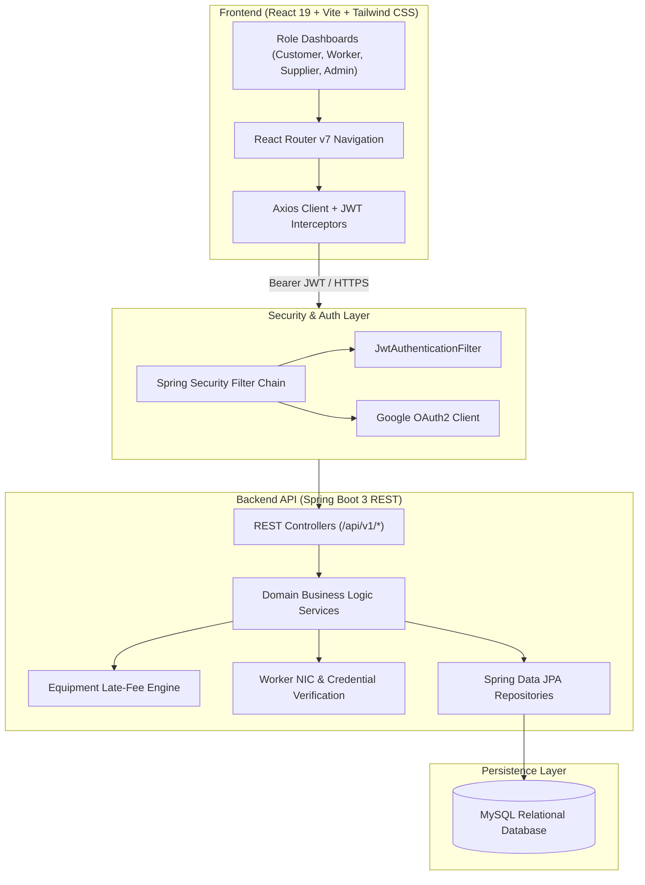

# 🛠️ Skill Connect | Skilled Worker & Equipment Booking Platform

[](https://spring.io/projects/spring-boot)
[](https://react.dev/)
[](https://spring.io/projects/spring-security)
[](https://www.mysql.com/)
[](https://tailwindcss.com/)
[](https://vitejs.dev/)

> **Skill Connect** is a full-stack, enterprise-grade multi-role marketplace that bridges the gap between verified skilled tradespeople, industrial/construction equipment suppliers, and everyday customers. Features four dedicated role-based portals, automated late-fee calculation, end-to-end booking lifecycles, and cryptographic JWT security.

---

## 🏛️ System Architecture



---

## 👥 Multi-Role User Workflows

Skill Connect implements strict **Role-Based Access Control (RBAC)** providing custom-tailored dashboards and authorization boundaries for 4 key personas:

| Role | Responsibilities & Capabilities |
| :--- | :--- |
| **👷 Skilled Worker** | Profile registration, NIC & trade verification submission, skills & hourly rate management, district availability, incoming job offer triage, and booking status updates. |
| **🚜 Equipment Supplier**| Machinery and tool catalog management (rental rates, specifications, image gallery), rental reservation monitoring, check-out/return inspections, and late-fee settlement. |
| **👤 Customer** | Smart geo/category worker search (by district, rate, rating, availability), job posting & direct hiring, equipment booking with date ranges, threaded messaging, and reviews. |
| **🛡️ System Admin** | Platform governance, worker credential verification (NIC/license review & approval), complaint dispute resolution with evidence photos, and user management. |

---

## ⚡ Core Engineering Highlights

### 1. 🧮 Automated Equipment Late-Fee Calculation Engine
* **Deterministic Overdue Logic:** Designed business logic that continuously tracks equipment return deadlines.
* **Automatic Grace Period & Multiplier:** Computes per-day overdue penalties automatically upon return submission, updating the reservation ledger without manual cashier intervention.

### 2. 🔐 Stateless JWT Security & Role Authorization
* **Cryptographic Token Verification:** Implemented with `jjwt` (Java JWT), validating request signatures on all protected API routes.
* **Hybrid Authentication:** Supports both native email/password credentials with BCrypt hashing and **Google OAuth2** identity federation.
* **Axios Interceptor Token Refresh:** Client-side interceptors automatically inject authorization headers and intercept `401 Unauthorized` responses for seamless session handling.

### 3. 🔍 Geo & Category Multi-Parameter Worker Search
* Dynamic backend query filtering across multiple criteria: trade specialty, geographic district, hourly rate range, customer rating thresholds, and real-time availability.

### 4. ⚖️ Review, Rating & Dispute Resolution System
* Closed-loop review system restricted to verified completed bookings to prevent fraudulent ratings.
* Multi-party complaint management system allowing customers and workers to lodge disputes with image uploads for administrative review and resolution.

---

## 🗄️ Database Design (Normalized Schema)

The MySQL database schema covers 10+ core entities with enforced relational integrity:
* `users` & `roles` (Authentication & identity)
* `worker_profiles` & `worker_skills` (Credentials, ratings, districts, hourly rates)
* `jobs` & `job_applications` (Lifecycle: `POSTED` → `APPLIED` → `ACCEPTED` → `COMPLETED`)
* `equipment` & `equipment_bookings` (Rentals, return timestamps, daily rates, calculated late fees)
* `messages` (Threaded in-app communication)
* `reviews` & `complaints` (Feedback scores, dispute status, supporting evidence URLs)

---

## 📂 Project Directory Structure

```text
Skill-Connect/
├── backend/                               # Spring Boot 3 Java Application
│   ├── src/main/java/com/skilledworker/
│   │   ├── config/                        # SecurityConfig, CORS, JWT filters
│   │   ├── controller/                    # Auth, Job, Worker, Equipment, Admin APIs
│   │   ├── dto/                           # Request & Response Data Transfer Objects
│   │   ├── model/                         # JPA Entities (User, Worker, Equipment, Booking...)
│   │   ├── repository/                    # Spring Data JPA Repository Interfaces
│   │   └── service/                       # Business Logic implementations
│   ├── src/main/resources/
│   │   └── application.properties         # Database connection, JWT secrets, SMTP config
│   └── pom.xml                            # Maven dependencies & build specifications
│
├── frontend/                              # React 19 Single Page Application
│   ├── src/
│   │   ├── components/                    # Reusable UI widgets, Navbar, Footer, Modals
│   │   ├── context/                       # AuthContext & global state providers
│   │   ├── pages/                         # Role-based views (Admin, Worker, Customer, Supplier)
│   │   ├── services/                      # Axios API service abstraction layer
│   │   └── App.jsx                        # Route definitions & protected route wrappers
│   ├── package.json                       # NPM dependencies & scripts
│   └── vite.config.js                     # Vite build configuration & plugins
│
└── database_schema.sql                    # Full MySQL DDL migration script
```

---

## 🚀 Getting Started

### Prerequisites
* **Java Development Kit (JDK):** Version 17 or higher
* **Apache Maven:** 3.8+
* **Node.js:** v18.0+ & `npm`
* **MySQL Server:** 8.0+

### 1. Database Setup
Create the MySQL database and import the schema:
```sql
CREATE DATABASE skilledworker_db;
```
Import the provided schema:
```bash
mysql -u root -p skilledworker_db < database_schema.sql
```

### 2. Backend Configuration & Launch
1. Navigate to the backend directory:
   ```bash
   cd backend
   ```
2. Update database credentials in `src/main/resources/application.properties`:
   ```properties
   spring.datasource.url=jdbc:mysql://localhost:3306/skilledworker_db?useSSL=false&serverTimezone=UTC
   spring.datasource.username=your_mysql_username
   spring.datasource.password=your_mysql_password
   jwt.secret=your_secure_256bit_jwt_secret_key
   ```
3. Run the Spring Boot application:
   ```bash
   ./mvnw spring-boot:run
   ```
   *The backend REST API will initialize on `http://localhost:8080`.*

### 3. Frontend Setup & Launch
1. Open a new terminal and navigate to the frontend directory:
   ```bash
   cd frontend
   ```
2. Install dependencies:
   ```bash
   npm install
   ```
3. Start the Vite development server:
   ```bash
   npm run dev
   ```
   *Access the web application at `http://localhost:5173`.*

---

## 👥 Academic & Engineering Credits

* **Academic Institution:** Sri Lanka Institute of Information Technology (SLIIT)
* **Program:** B.Sc. (Hons) in Information Technology — Specializing in Software Engineering
* **Project Type:** Year 3 Semester 1 Software Engineering Capstone Project (Team of 5)
* **Author / Contributor:** **Mohamed Lithaf Awfadh** ([@lithafawfadh](https://github.com/lithafawfadh))
  * *Core Responsibilities:* Spring Security & JWT Architecture, Equipment Late-Fee Calculation Engine, Worker Credential & NIC Verification Workflow, Admin Governance Dashboards, and Full-Stack Integration.

---

## 📄 License
This project was developed for educational and portfolio demonstration purposes. All rights reserved.
